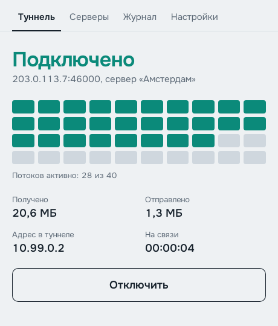

# csqtt-linux

Linux-клиент туннеля [CSQTT](https://github.com/amurcanov/csqtt): системная служба, окно управления и утилита командной строки.



Клиент лежит в папке `linux/` форка [amurcanov/csqtt](https://github.com/amurcanov/csqtt). Код ядра в корне форка не меняется: `rust-client` собирается под Linux без единой правки и запускается отдельным процессом — так же, как его запускает Android-приложение. Этот проект реализует только то, что на Android делает Kotlin-часть: TUN-интерфейс, маршруты, DNS, перезапуски и показ капчи. Новое ядро приходит в форк кнопкой «Sync fork», после чего достаточно пересобрать пакет.

Окно (Tauri 2 + Vue 3) и команда `csqtt` — два равноправных клиента одного сокета демона: серверы общие, туннель переживает закрытие окна.

## Как это устроено

```text
 csqtt-gui (окно)   csqtt (CLI)         csqtt-captcha (окно проверки VK)
        │  JSON по /run/csqtt/csqttd.sock          ▲ запускается окном, CLI или агентом
        ▼                                          │
 csqttd (root)  ── создаёт csqtt0, ip rule/route, DNS, следит за ядром
        │  argv + stdin/stdout, TUN-fd через SCM_RIGHTS
        ▼
 csqtt-core (пользователь csqtt-core) ── TURN/VK, шифрование, протокол
```

- **csqttd** работает от root, но само ядро запускает от отдельного пользователя `csqtt-core` без привилегий и с пустым окружением.
- **Обход туннеля для самого ядра** сделан правилом `ip rule … uidrange`: трафик пользователя `csqtt-core` (TURN-серверы VK, API, прямые соединения) идёт по обычной таблице, всё остальное — в `csqtt0`. Это аналог `addDisallowedApplication` на Android, и ему не нужны списки подсетей VK.
- **Локальные сети** остаются доступными (`suppress_prefixlength 0`, как у wg-quick).
- **Kill switch**: интерфейс и правила держит демон, а не ядро. Если ядро упало или перезапускается, трафик не уходит мимо туннеля, пока ты не выполнишь `csqtt down`.
- **IPv6**: туннель передаёт только IPv4, поэтому на время работы IPv6 наружу блокируется (настройка `ipv6` в конфиге демона).

## Установка (Ubuntu / Debian / Mint)

Готовый пакет — в разделе [Releases](https://github.com/pvtarget-glitch/csqtt-linux/releases).

```bash
sudo apt install ./csqtt-linux_0.2.1+core2.5.0_amd64.deb
```

Пакет создаёт пользователя `csqtt-core` и группу `csqtt`, добавляет в группу того, кто ставил через `sudo`, и запускает `csqttd`. После установки в меню приложений появляется «csqtt». Готовому пакету нужен glibc 2.39 или новее (Ubuntu 24.04+, Mint 22+, Debian 13+); для более старых систем собери из исходников на них же.

### Сборка из исходников

```bash
sudo apt install build-essential cmake git pkg-config nodejs npm \
  libwebkit2gtk-4.1-dev libgtk-3-dev libayatana-appindicator3-dev librsvg2-dev
# Rust: https://rustup.rs (ядру нужен 1.97.1 или новее); Node.js — 20 или новее
git clone https://github.com/pvtarget-glitch/csqtt-linux.git
cd csqtt-linux/linux
scripts/build-deb.sh          # соберёт ядро, демон, окно, CLI и dist/*.deb
sudo apt install ./dist/csqtt-linux_*.deb
```

## Окно

Запусти «csqtt» из меню приложений или командой `csqtt-gui`.

- **Туннель.** Вставь ссылку `csqtt://` и нажми «Подключить». Поле ячеек показывает потоки туннеля: ряд — группа из десяти, закрашенные — активные.
- **Серверы.** Добавление по ссылке, правка всех настроек, замена хешей VK-звонков, копирование ссылки.
- **Журнал.** Журнал ядра с начала сессии, поиск и копирование.
- **Настройки.** Автозапуск при входе в систему, сворачивание в трей.

Окно само показывает проверку VK и присылает уведомления о подключении и обрыве. Значок в трее меняется вместе с состоянием; из его меню можно подключиться и отключиться.

## Командная строка

```bash
csqtt import 'csqtt://…'            # профиль из ссылки (та же, что в Android-клиенте)
csqtt up                            # подключиться
csqtt status                        # состояние, адрес, потоки, трафик
csqtt logs -f                       # журнал ядра
csqtt logs -n 0                     # весь журнал сессии с первой строки
csqtt down                          # отключиться и вернуть маршруты/DNS
```

Если в ссылке нет хешей VK-звонков или звонок завершился:

```bash
csqtt hashes ИМЯ https://vk.com/call/join/…  ещё_хеш
```

Остальные команды: `profiles`, `show`, `default`, `remove`, `export`, `config-path`.

### Капча

Ядро сначала решает проверку VK само (режим `auto`). Если не получилось, оно просит хост показать страницу человеку — тогда открывается окно, ты проходишь проверку, а токен уходит ядру.

- Запущенное окно csqtt показывает проверку само — в том числе когда свёрнуто в трей.
- `csqtt up` без окна показывает проверку, пока идёт подключение.
- Если работаешь только из командной строки, держи запущенным агент, чтобы проверка появлялась и после подключения:

  ```bash
  systemctl --user enable --now csqtt-agent
  ```

Если запущено несколько клиентов, проверку показывает один — подключившийся последним.

«Автоматический WebView» из Android-клиента (страница, которая проходит проверку сама) здесь намеренно не реализован: на такой запрос демон сразу отвечает отказом, и ядро переходит к следующему шагу своей цепочки.

### Настройки профиля

Профили лежат в `~/.config/csqtt/profiles.toml` (права 0600). `import` заполняет адрес, пароль и хеши; остальное правится в файле:

```toml
[[profile]]
name = "vps"
host = "203.0.113.7"
port = 46000
password = "…"
hashes = ["…"]              # либо vk_token = "…" (ядро само создаёт звонки)
workers = 18                # ядро округлит до 10; максимум 100
fingerprint = "firefox"     # chrome | firefox | safari | edge | opera
turn_transport = "udp"      # udp | tcp_tls
srtp_mode = "auto"          # auto | wrap-srtp | dtls-srtp
captcha_mode = "auto"       # auto | rjs | wv (сразу окно)
vk_auth_mode = "vkcalls"    # vkcalls | legacy | auto_js (только с vk_token)
persistent = false          # true — переподключаться без ограничения попыток

[profile.routing]
domain_mode = "blacklist"   # off | blacklist | whitelist
exclude_ru_zones = true     # .ru/.su/.рф напрямую
template_domains = false    # список доменов из поставки ядра
domains = ["example.com"]
ip_mode = "blacklist"       # off | blacklist | whitelist
ips = ["192.0.2.0/24"]
```

Значения по умолчанию совпадают с Android-клиентом. Правила маршрутизации, заданные в веб-панели сервера, имеют приоритет над локальными.

Настройки демона (имя интерфейса, таблица, DNS, IPv6) — в `/etc/csqtt/csqttd.toml`.

## Обновление ядра

```bash
# 1. На странице форка: Sync fork → Update branch
#    (или локально: git remote add upstream https://github.com/amurcanov/csqtt.git;
#     git fetch upstream && git merge upstream/main)
git pull
scripts/build-core.sh              # пересобрать ядро
scripts/build-deb.sh --no-core     # упаковать
```

Хост зависит только от внешнего контракта ядра: аргументы командной строки, события `__CSQTT_EVENT__|…`, команды stdin и передача TUN-fd. Проверить, что новое ядро его не нарушило:

```bash
CSQTT_CORE_BIN="$PWD/dist/csqtt-core" cargo test -p csqttd -- --ignored
```

Тест запускает настоящее ядро с аргументами демона, передаёт ему TUN-fd и останавливает командой `STOP`. Неизвестные типы событий демон не считает ошибкой и пишет в журнал.

## Ограничения

- **Окно капчи при поднятом туннеле** ходит на VK через туннель (с адреса сервера), тогда как ядро — напрямую. На Android оба запроса идут напрямую. При первом подключении разницы нет; если VK будет отклонять проверку во время работы туннеля, сделай `csqtt down && csqtt up`.
- **Режим Auto API** Android-клиента (приложение само создаёт звонки через вход в VK) не перенесён. Работают хеши вручную и `vk_token` (Auto JS).
- **Развёртывание сервера по SSH** из приложения не перенесено — сервер ставится штатными средствами csqtt.
- Сокет, по которому ядро принимает TUN-fd, абстрактный и без проверки отправителя (так устроено ядро). Локальный процесс, знающий имя сокета, может подсунуть ядру свой дескриптор. На однопользовательской машине это не расширяет возможности атакующего, на общей — учитывай.
- Входящие соединения к этой машине из интернета при поднятом туннеле не работают (ответы уходят в туннель), из локальной сети — работают.

## Что проверено

- Модульные тесты: `cargo test`.
- Формат ссылок сверен с независимой реализацией алгоритма из Kotlin-кода: `python3 tests/link_compat.py target/debug/csqtt`.
- Сетевая часть (TUN, передача fd, правила, DNS через resolv.conf, перезапуски, капча, права на сокет) — `sudo tests/integration.sh`: 86 проверок в отдельном network namespace с имитатором ядра.
- На настоящем сервере csqtt 2.5.0 из командной строки: туннель поднимается, ядро получает TUN-интерфейс и конфигурацию, DNS ставится через resolv.conf.
- Окно под виртуальным дисплеем на стенде `tests/gui-env.sh`: добавление сервера по ссылке, подключение и отключение, состояния ошибки и проверки VK, журнал, запись автозапуска, запрет второго экземпляра.
- Настоящее ядро 2.5.0: принимает аргументы демона, получает TUN-fd, останавливается по `STOP`.
- Окно капчи: перехват токена через fetch и XHR на локальной странице-заглушке.

Не проверено (в среде сборки не было ни рабочего стола, ни systemd, ни IPv6):

- значок в трее и сворачивание в него на настоящем рабочем столе, работа окна под Wayland;
- настройка DNS через systemd-resolved (`resolvectl`) и работа под unit-файлом systemd;
- блокировка IPv6;
- поведение при смене сети и после сна.

## Лицензия

Ядро CSQTT — © 2026 amurcanov, [PolyForm Noncommercial 1.0.0](../LICENSE): только некоммерческое использование. Этот проект распространяется на тех же условиях. Проект не связан с FOCSQ и не использует его код или дизайн.
